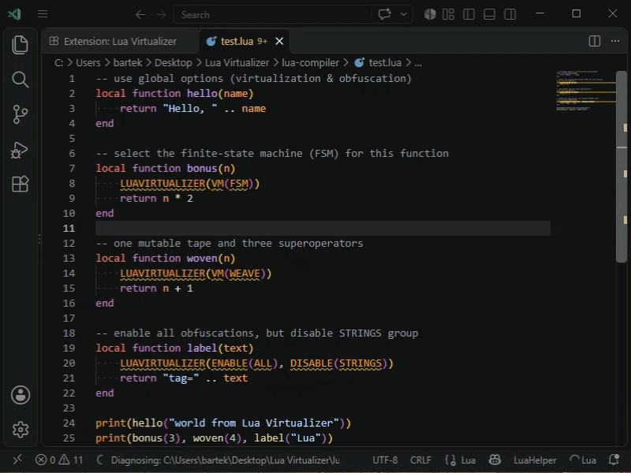
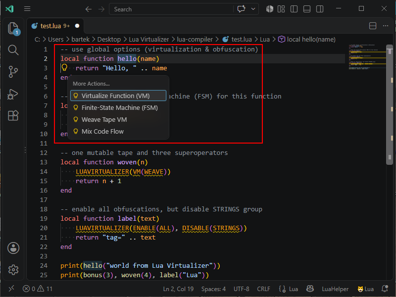
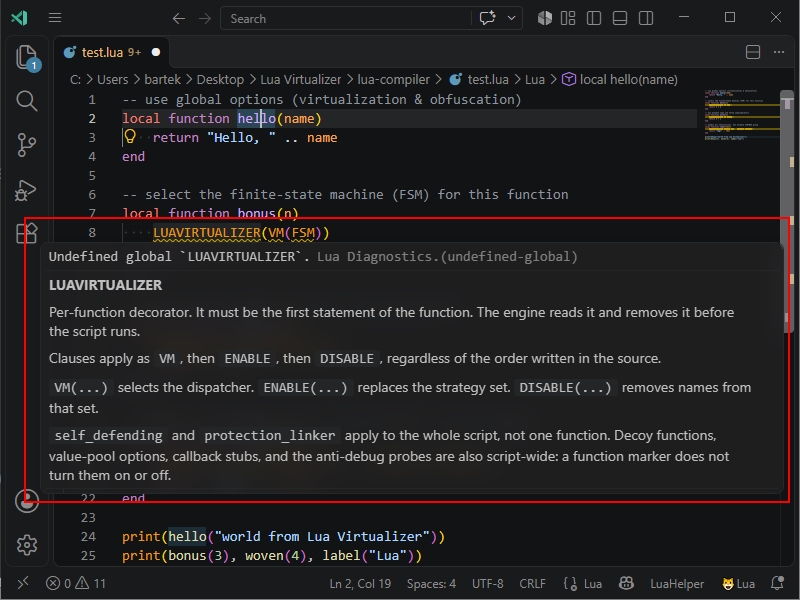
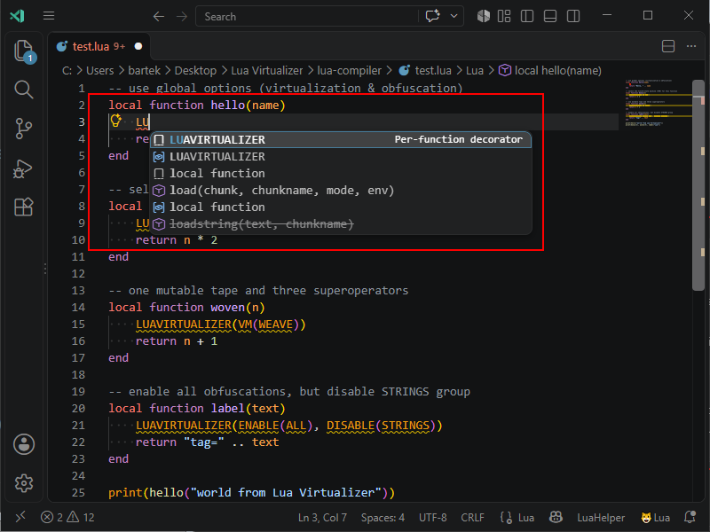

# Lua Virtualizer Extension for Visual Studio Code

[Lua Virtualizer](https://www.pelock.com/products/lua-virtualizer) is an advanced Lua virtualizer & obfuscator for `.lua` scripts with a VM engine, finite-state machine (FSM) transforms, weave tape, self-integrity checks, polymorphic string encryption, anti-debugging and many more obfuscation methods!

## Install for VS Code

- [https://marketplace.visualstudio.com/items?itemName=PELock.lua-virtualizer](https://marketplace.visualstudio.com/items?itemName=PELock.lua-virtualizer)

## Install for VS Code compatible editors (Cursor etc.)

- [https://open-vsx.org/extension/PELock/lua-virtualizer](https://open-vsx.org/extension/PELock/lua-virtualizer)

## Simple & fast Lua virtualization directly in your IDE

Turn a readable Lua script into a protected version that is much harder to analyze and rebuild.

## How to use it in Visual Studio Code?

The extension activates for Lua files (`.lua`, `.luau`, `.wlua`). The **Virtualize** command is shown only for those files.

### 1. Virtualize

1. Open a Lua script in the editor
2. Open the Command Palette (`Ctrl+Shift+P` / `Cmd+Shift+P`) and run **Virtualize**, or right-click a Lua file (editor, tab, or Explorer) and choose **Lua Virtualizer**
3. The file content is sent to the Lua Virtualizer Web API (`https://www.pelock.com/api/lua-virtualizer/v1`)
4. A new `virtualized.{original extension}` file is opened (for example `virtualized.lua`) and becomes the active tab

Keyboard shortcut: `Ctrl+Alt+O` (`Cmd+Alt+O` on macOS).

> Note: Without an activation code the extension runs in **Demo mode**. Only flat code virtualization is applied, other options are ignored, and script length is limited to 1000 bytes.

### 2. Configure virtualization options

1. Open Visual Studio Code **Settings**
2. Search for **Lua Virtualizer**
3. Enter your activation code (API key), or leave it empty for Demo mode
4. Enable or disable individual obfuscation strategies (labels match the [online virtualizer](https://www.pelock.com/lua-virtualizer/))
5. Optionally set a source dialect, random seed, randomization density, rename style, and code virtualization mode (`vm` / `fsm` / `weave` / `flat` / `rnd`)

## VS Code Action Menu

Place the cursor on a named function and open the lightbulb **Actions** menu. The menu virtualizes only that function, in the dispatcher you pick:

- **Virtualize Function (VM)**
- **Finite-State Machine (FSM)**
- **Weave Tape VM**
- **Mix Code Flow**

The selected function is virtualized in that mode with the safe obfuscation set turned on. Every other named function stays plain Lua and keeps its original signature, for example `local function hello(name)`. The editor buffer is left unchanged, and the result opens as `virtualized.lua`.

## VS Code Hints

Hover a `LUAVIRTUALIZER` marker to read what it does. The hint explains that the marker is the first statement of the function and that the engine removes it before the script runs. It also describes how `VM`, `ENABLE`, and `DISABLE` combine, and which options apply to the whole script: self-defending, the protection linker, decoy functions, and the anti-debug probes.

## Code completion helper

At the start of a function body, type `LU` and accept **LUAVIRTUALIZER** from the completion list. Inside the call, completions offer `VM`, `ENABLE`, and `DISABLE`, then the VM modes and the per-function strategy names.

## Why Lua scripts need protection?

Scripts are typically distributed as plain `.lua` files or bundled inside a host application. That convenience means anyone with file access can read the full logic, hunt for credentials or API keys in strings, and steal your algorithms unless you take extra steps to hide intent.

[Lua](https://www.lua.org/) is a small, embeddable scripting language. It is widely used for game logic, plugins, configuration, automation, and agent code that customers run on their own machines.

## Obfuscation strategies

Lua Virtualizer comes with many advanced obfuscation, virtualization & protection strategies. You can easily tune protection versus size and performance from the extension **Settings** page.

###  Powerful obfuscation

Lua Virtualizer uses polymorphic string encryption, integer and float rewriting, MBA operator rewriting, and decoy noise. The result conceals literals and structure while preserving tested runtime behaviour.

###  Code virtualization

Selected functions are compiled to encrypted register bytecode and run in a handler interpreter. Opcode encoding and generated names vary with the seed. The bytecode checksum is the integrity check. **Weave tape** runs that bytecode on one mutable tape: superoperators step the tape and rewrite it as execution moves. **Mix code flow** flattens dispatch into a schedule of numbered blocks, where the current block selects the next one.

###  Finite-state machine (FSM)

Finite-state machine (FSM) virtualization runs the same bytecode as a state machine. Opcodes are split into states and dispatched from those states. Encoding and names vary with the seed. Analysts must follow numeric states and decoy paths to reconstruct the original order.

###  Anti-debugging

Anti-debugging protection inserts probes that detect attached debuggers (`debug.gethook()`, and `IsDebuggerPresent` on Windows), together with anti-VM, anti-sandbox and anti-emulator checks. When a check fires, the protected script exits silently instead of revealing protected logic under interactive analysis.

###  Self-integrity checks

A final anti-tamper pass inserts an integrity probe that fingerprints the loaded chunk. Decrypt and trip keys are derived from that live token, so edits poison later transforms and return garbage instead of plaintext. The probe does not need a separate copy of the script on disk.

###  Protection linker

A late pass wires honeypot resolvers, bogus helper calls with random arguments, and shallow-stack tripwires that stay active only before bootstrap completes. Extracted snippets keep noisy call surfaces that look real under static review. Normal execution after a successful integrity check remains unchanged. The linker requires self-defending.

### How does Lua Virtualizer work?

The engine parses Lua source, then applies selectable transforms: identifier renaming, VM / FSM / weave / flat virtualization, polymorphic string and integer encryption, noise and decoy insertion, self-defending integrity probes, the protection linker, and anti-debugging checks. Automatic dialect detection tries 5.1, then 5.2, 5.3, 5.4, 5.5, then Luau, and keeps the oldest dialect that parses. LuaJIT is selected only when you choose it.

When all passes finish, the engine emits a new `.lua` script. Edge cases in the Lua grammar and hosting environments mean you should always test the output in your target runtime.

## Lua Virtualizer features

- Out of the box support for Lua scripts (`.lua`, `.luau`, `.wlua`)
- Source dialect (`auto`, `5.1`–`5.5`, LuaJIT, Luau)
- Configurable obfuscation strategies (renaming, string/integer encryption, VM, FSM, weave, flat, anti-debug, self-defending, and more)
- Code virtualization mode (`vm` / `fsm` / `weave` / `flat` / `rnd`) with an enable/disable switch
- Rename style, seed, and randomization density
- Demo mode when no activation code is set
- Visual Studio Code command, context menu, and keyboard shortcut
- You can automate virtualization in your builds using the [Web API](https://www.pelock.com/products/lua-virtualizer/api)

## Available editions

Lua Virtualizer can be used:

- Directly on its website — [https://www.pelock.com/lua-virtualizer/](https://www.pelock.com/lua-virtualizer/)
- You can download standalone Windows GUI & command-line clients — [https://www.pelock.com/products/lua-virtualizer/download](https://www.pelock.com/products/lua-virtualizer/download)
- You can use it via WebAPI interface — [https://www.pelock.com/products/lua-virtualizer/api](https://www.pelock.com/products/lua-virtualizer/api)
- ...and **now** also as a Visual Studio Code extension — [https://marketplace.visualstudio.com/items?itemName=PELock.lua-virtualizer](https://marketplace.visualstudio.com/items?itemName=PELock.lua-virtualizer)

Product screenshots (Windows GUI, options panel, CLI) live on the [screenshots page](https://www.pelock.com/products/lua-virtualizer/screenshots).

## Extension settings

You can fine-tune virtualization settings in the extension **Settings** page.

- **Activation code (API key)** — leave empty to run in Demo mode
- **Compress source code** before sending it to the Web API
- **Seed**, **randomization density**, and **rename style**
- **Dialect** (`auto`, `5.1`, `5.2`, `5.3`, `5.4`, `5.5`, `luajit`, `luau`)
- **Code virtualization** enable switch plus mode (`vm`, `fsm`, `weave`, `flat`, `rnd`)
- Every obfuscation strategy from the [online virtualizer](https://www.pelock.com/lua-virtualizer/), with the same labels and descriptions

## Free demo version limitations

The free demo version comes with some **limitations**.

| Feature                         | Demo version | Full version |
| ------------------------------- | ------------ | ------------ |
| Script virtualization           | flat only    | ✅            |
| Virtualize code (VM)            | ❌            | ✅            |
| Finite-state machine (FSM)      | ❌            | ✅            |
| Weave tape                      | ❌            | ✅            |
| Mix code flow (flat)            | ✅            | ✅            |
| Obfuscation strategies          | ❌            | ✅            |
| Max. script length (bytes)      | `1000`       | `10 000 000` |

## Pricing

To remove the limitations and support our project and its development, you need to buy an activation code at:

[https://www.pelock.com/products/lua-virtualizer/buy](https://www.pelock.com/products/lua-virtualizer/buy)

Each activation code unlocks **unlimited** virtualizations until the license expiration date. An empty expiration means the license **does not expire**. The API reports `usages_total` as a lifetime counter for that code, not a remaining quota.

## How to get a free activation code?

You can get a **free activation code** if you can advertise Lua Virtualizer with a link to the product site [https://www.pelock.com/products/lua-virtualizer](https://www.pelock.com/products/lua-virtualizer) at:

- Write a blog post or an article about Lua Virtualizer with some [screenshots](https://www.pelock.com/products/lua-virtualizer/screenshots), code examples and a link to the product site
- Post on X about Lua Virtualizer with a link to the product page — use the `#lua` `#virtualizer` & `#obfuscation` hashtags
- Report a bug and if it can be confirmed you will get a free activation code as a thank you
- Suggest an obfuscation idea with some code samples

Send me all the details at my [contact address](https://www.pelock.com/contact) and if it's legit — **bam!**, you got yourself a free code :)

## Changelog

### 2026-10-15

Initial release of the Lua Virtualizer Visual Studio Code extension.

- **Virtualize** command for Lua files (`.lua`, `.luau`, `.wlua`), opened as `virtualized.{original extension}`
- Action menu virtualizes only the selected function (VM, FSM, weave, or flat). Other named functions stay plain Lua and keep their original signatures
- `LUAVIRTUALIZER` highlighting, hover hints, and code completion
- Settings panel for the activation code, source dialect, virtualization mode, and every obfuscation strategy
- Demo mode when no activation code is entered (flat virtualization only, 1000 byte limit)

Bartosz Wójcik

- Visit my site at — [https://www.pelock.com](https://www.pelock.com)
- X — [https://x.com/PELock](https://x.com/PELock)
- GitHub — [https://github.com/PELock](https://github.com/PELock)
